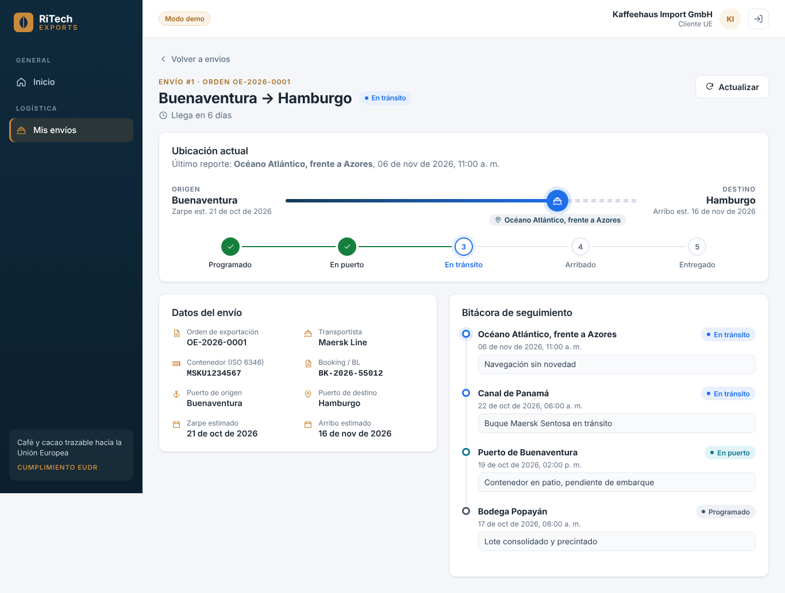
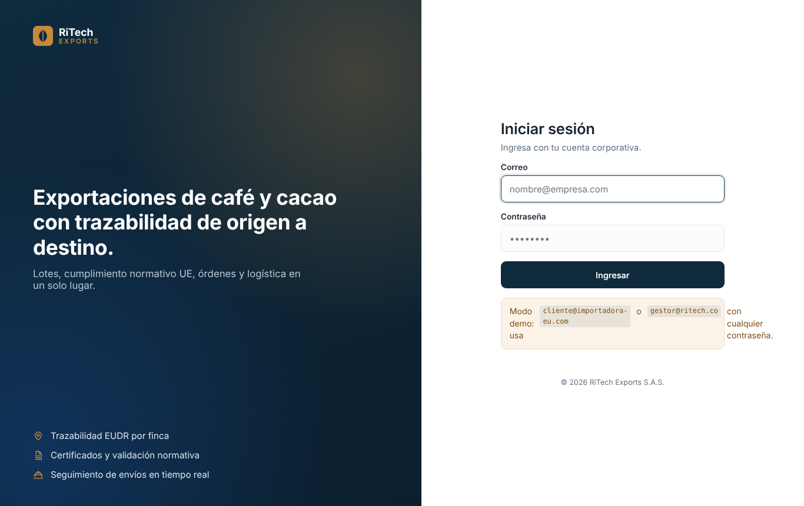
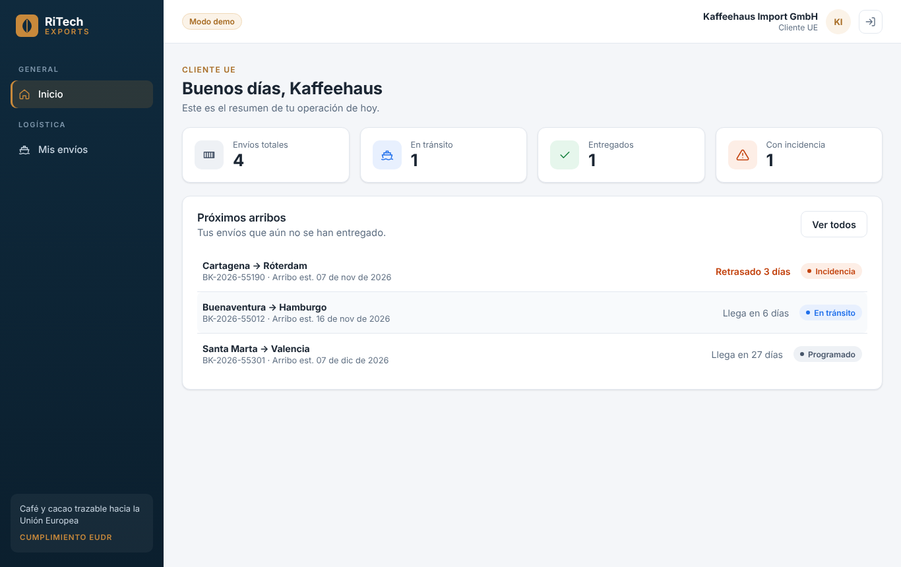
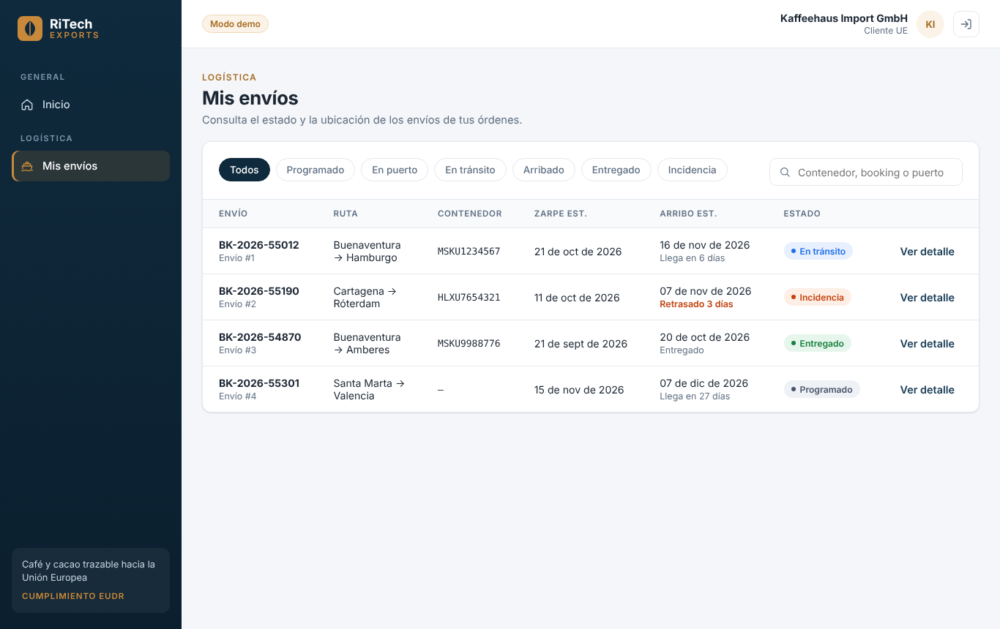
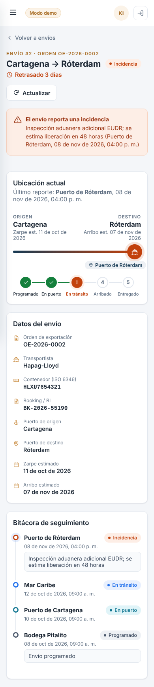

<div align="center">

# RiTech Exports · Frontend

**Plataforma web para gestionar exportaciones de café y cacao hacia la Unión Europea, con trazabilidad de origen a destino.**

[](https://ritech-frontend-atwu.onrender.com)


[Demo en vivo](https://ritech-frontend-atwu.onrender.com) · [API (Swagger)](https://backend-ritech-f1oo.onrender.com/docs) · [Backend](https://github.com/walterjojoa/BACKEND-CACAO) · [Base de datos](https://github.com/camilin0811/BASE-DE-DATOS-RITECH-EXPORTS) · [Tablero Jira](https://cammb1004.atlassian.net/jira/software/projects/SCRUM/boards/1)



</div>

## Contenido

- [Sobre el proyecto](#sobre-el-proyecto)
- [Demo en vivo](#demo-en-vivo)
- [Funcionalidades](#funcionalidades)
- [Capturas](#capturas)
- [Tecnologías](#tecnologías)
- [Arquitectura](#arquitectura)
- [Ejecutar en local](#ejecutar-en-local)
- [Despliegue](#despliegue)
- [Historias de usuario (Scrum)](#historias-de-usuario-scrum)
- [Estructura del proyecto](#estructura-del-proyecto)
- [Equipo](#equipo)

## Sobre el proyecto

RiTech Exports es un sistema para empresas exportadoras colombianas de café y cacao que venden a importadores
de la Unión Europea. Cubre todo el ciclo: registro de productores y fincas con geolocalización, lotes de
exportación, inspección de calidad, certificados, validación del cumplimiento normativo europeo (EUDR),
órdenes de exportación y logística del envío hasta su entrega.

Este repositorio contiene la **interfaz web**. Se conecta a la API REST de
[BACKEND-CACAO](https://github.com/walterjojoa/BACKEND-CACAO) (Java 17 · Spring Boot · MySQL) mediante
autenticación JWT.

El proyecto se desarrolla con **Scrum** en el curso de Calidad de Software de la Universidad Cooperativa de
Colombia. El trabajo se organiza en Jira (proyecto `SCRUM`) y la documentación en Confluence.

## Demo en vivo

| Componente | URL |
|---|---|
| Frontend | https://ritech-frontend-atwu.onrender.com |
| API REST | https://backend-ritech-f1oo.onrender.com |
| Documentación de la API (Swagger) | https://backend-ritech-f1oo.onrender.com/docs |
| Base de datos | MySQL 8 administrado en Aiven |

La aplicación desplegada trabaja con **datos reales** del backend. Usuarios de prueba:

| Rol | Correo |
|---|---|
| Cliente UE (importador) | `cliente@importadora-eu.com` |
| Gestor de exportaciones | `gestor@ritech.co` |
| Administrador | `admin@ritech.co` |
| Inspector de calidad | `inspector@ritech.co` |

Contraseña de todas las cuentas de prueba: `626588b636c79dd6116fe404f3e8ca43`. En la pantalla de inicio de sesión
basta con tocar una cuenta para llenar el formulario.

> El backend corre en el plan gratuito de Render: si lleva un rato sin uso, la primera petición puede tardar
> cerca de un minuto mientras el servidor despierta.

## Funcionalidades

### Inicio de sesión y roles
- Inicio de sesión con correo y contraseña contra `POST /api/auth/login` (token JWT).
- La sesión se guarda en el navegador y se cierra sola cuando el token expira.
- El menú y las pantallas se adaptan al rol del usuario: Administrador, Gestor de exportaciones,
  Inspector de calidad y Cliente UE.

### Panel de inicio
- Saludo personalizado y resumen de la operación.
- Indicadores: envíos totales, en tránsito, entregados y con incidencia.
- Próximos arribos ordenados por fecha, con aviso de retraso.

### Envíos (SCRUM-30: consultar estado y ubicación del envío)
- Listado con filtro por estado (Programado, En puerto, En tránsito, Arribado, Entregado, Incidencia)
  y búsqueda por contenedor, booking o puerto.
- Un Cliente UE solo ve los envíos de sus propias órdenes.
- Detalle de cada envío:
  - Ruta origen → destino con la **ubicación del último reporte**.
  - Avance por etapas del envío.
  - **Alerta destacada** cuando hay una incidencia y **aviso de retraso** frente al arribo estimado.
  - Datos del envío: orden, transportista, contenedor ISO 6346, booking/BL, fechas de zarpe y arribo.
  - **Bitácora completa** de eventos de seguimiento.

### Calidad de la interfaz
- Diseño adaptable a escritorio, tableta y celular.
- Estados de carga, vacío y error en cada pantalla, con opción de reintentar.
- Los mensajes de error del backend (validaciones, reglas de negocio, permisos) se muestran tal cual al usuario.
- Código revisado con ESLint.

## Capturas

| Inicio de sesión | Panel de inicio |
|---|---|
|  |  |

| Listado de envíos | Envío con incidencia (celular) |
|---|---|
|  |  |

## Tecnologías

| Área | Herramienta |
|---|---|
| Interfaz | React 19 |
| Empaquetado y servidor de desarrollo | Vite 6 |
| Navegación | React Router 7 |
| Estilos | CSS propio con variables de diseño (sin librerías externas) |
| Calidad de código | ESLint |
| Despliegue | Render (frontend y backend) · Aiven (MySQL) |
| Backend | Java 17 · Spring Boot 3.5 · Spring Security (JWT) · MySQL 8 |

## Arquitectura

```
 Navegador ──► Frontend React ──HTTPS + JWT──► API Spring Boot ──► MySQL 8
               (Render, estático)              (Render)            (Aiven)
```

- El frontend no guarda reglas de negocio: las validaciones y permisos viven en el backend y la base de datos.
- Cada petición envía el token en la cabecera `Authorization: Bearer …`.
- Si el backend responde 401, la sesión se cierra y se vuelve al inicio de sesión.

## Ejecutar en local

**Requisitos:** Node.js 18 o superior. Para datos reales, el backend corriendo en `http://localhost:8080`
(ver su [README](https://github.com/walterjojoa/BACKEND-CACAO#ejecutar-en-local)).

```bash
git clone https://github.com/Santiago425/ritech-frontend.git
cd ritech-frontend
npm install
cp .env.example .env     # en Windows: copy .env.example .env
npm run dev
```

Abre `http://localhost:5173` e ingresa con un usuario semilla del backend.
El backend ya acepta peticiones desde `http://localhost:5173` (variable `ALLOWED_ORIGINS`).

**Sin backend:** pon `VITE_MODO_DEMO=true` en `.env` y la aplicación usará los datos de ejemplo.

### Variables de entorno

| Variable | Para qué | Por defecto |
|---|---|---|
| `VITE_API_URL` | URL base del backend | `http://localhost:8080` |
| `VITE_MODO_DEMO` | Usar datos de ejemplo sin backend | `false` |

### Scripts

| Comando | Qué hace |
|---|---|
| `npm run dev` | Servidor de desarrollo |
| `npm run build` | Compila para producción en `dist/` |
| `npm run preview` | Sirve la compilación de `dist/` |
| `npm run lint` | Revisa el código con ESLint |

## Despliegue

El sitio está publicado en **Render** como sitio estático, definido en [`render.yaml`](render.yaml):

- Compila con `npm ci && npm run build` y publica la carpeta `dist/`.
- Todas las rutas se redirigen a `index.html` para que funcione la navegación de React Router.
- Cada push a `main` se despliega automáticamente.
- Al ser sitio estático, no se suspende por inactividad.

**Conexión con el backend:** `render.yaml` define `VITE_API_URL=https://backend-ritech-f1oo.onrender.com` y
`VITE_MODO_DEMO=false`. El backend debe incluir `https://ritech-frontend-atwu.onrender.com` en su variable
`ALLOWED_ORIGINS` para aceptar las peticiones del navegador.

## Historias de usuario (Scrum)

Sprint 4: **Logística, reportes y cierre**.

| Historia | Descripción | Estado en el frontend |
|---|---|---|
| SCRUM-8 | Iniciar sesión | ✅ Hecho |
| SCRUM-30 | Como cliente de la UE quiero consultar el estado y la ubicación de mi envío | ✅ Hecho |
| SCRUM-29 | Como gestor quiero registrar eventos de seguimiento del envío | ⏳ Pendiente |
| SCRUM-31 | Como administrador quiero un tablero con toneladas exportadas y porcentaje de rechazo | ⏳ Pendiente |
| SCRUM-32 | Como administrador quiero exportar reportes de cumplimiento normativo a hoja de cálculo | ⏳ Pendiente |
| SCRUM-66 | Manual de usuario por rol (Confluence) | ⏳ Pendiente |

## Estructura del proyecto

```
ritech-frontend/
├── docs/capturas/        capturas de pantalla
├── public/               ícono del sitio
├── src/
│   ├── api/              cliente HTTP, manejo de errores y datos del modo demo
│   ├── auth/             sesión, rol y permisos del usuario
│   ├── components/       menú, ruta del envío, etapas, bitácora, estados de carga
│   ├── pages/            login, inicio, envíos y detalle del envío
│   ├── styles/           estilos globales y diseño adaptable
│   ├── hooks.js          carga de datos desde la API
│   └── utils.js          estados del envío, fechas y cálculo de retrasos
├── render.yaml           configuración de despliegue en Render
└── .env.example          variables de entorno de ejemplo
```

## Equipo

| Integrante | Rol |
|---|---|
| Santiago Alejandro Campoverde Obando | Frontend |
| Walter René Jojoa | Backend y frontend |
| Manuel Alejandro Villarreal | Analista |
| Camilo Bolaños | Pruebas y base de datos |
| Felipe Alejandro Cerón Cifuentes | Despliegue y revisión técnica |

---

<div align="center">
Universidad Cooperativa de Colombia · Calidad de Software · 2026
</div>
